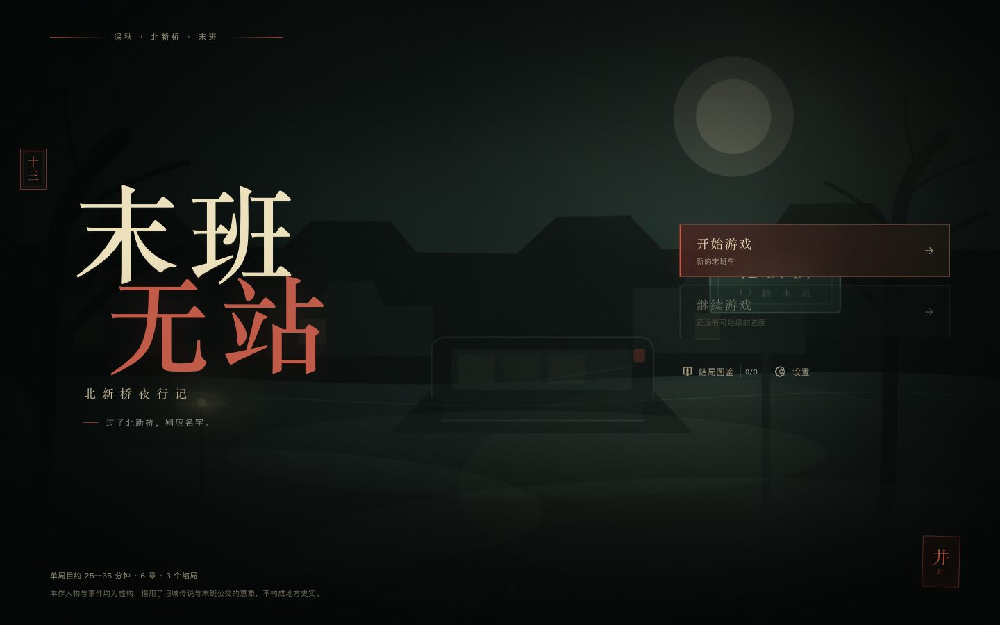
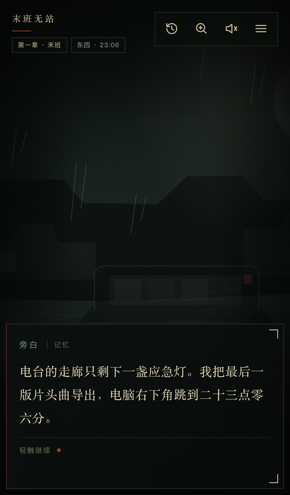

# 末班无站

**北新桥夜行记** — 一部可离线安装的中文恐怖视觉小说。

深秋的北京旧城，二十三点零六分。你加完班，误上一辆没有开灯的 13 路末班车。车过了北新桥，报站器说下一站是“井儿胡同”，可你在这附近住了三年，从没听说有这个站。

> 过了北新桥，别应名字。

- 单周目约 **25—35 分钟**，6 章，3 个正式结局
- 第一人称阅读，选择、线索、条件分支与代价明确的收束
- 纯本地资源：原创 SVG/CSS 场景、Web Audio 合成环境声，无 CDN、无后端
- PWA：可安装、可离线刷新、自动与手动存档、结局图鉴

**在线游玩：<https://do-fei.github.io/moban-wuzhan/>**（GitHub Pages，HTTPS）





## 在线游玩与安装

- Mac Chrome / Edge：打开 <https://do-fei.github.io/moban-wuzhan/>，满足条件时地址栏右侧会出现安装图标。
- iPhone Chrome：先在 Chrome 中打开同一网址；点击分享按钮，选择“添加到主屏幕”或“Add to Home Screen”。iPhone 上的 Chrome 仍使用系统 WebKit 内核；如果 Chrome 的分享菜单中没有该入口，可改用 Safari 的“分享 → 添加到主屏幕”，或直接保留网页游玩。
- 安装或添加到主屏幕后，可离线启动；首次仍需联网成功加载一次以完成缓存。
- GitHub Pages 站点天然提供 HTTPS，满足 Service Worker 与安装条件。

## 快速开始

需要 Node.js 20.19+ 或 22.12+（本项目实际使用 Node 22.22.2、npm 10.9.7 验证）。

```bash
npm install
npm run dev
```

打开终端输出的本地地址（通常为 `http://127.0.0.1:5173/`）。

生产构建与本地预览（默认根路径）：

```bash
npm run build
npm run preview
```

预览地址为 `http://127.0.0.1:4173/`。**Service Worker 只在生产构建中注册**，所以开发服务器不能用于离线验证。

部署到 GitHub Pages 子路径时：

```bash
npm run build:pages
# 等价于 VITE_BASE_PATH=/moban-wuzhan/ npm run build
# 将 dist/ 的内容发布到 gh-pages 分支
```

Manifest、图标和 Service Worker 会随 `VITE_BASE_PATH` 自动使用 `/moban-wuzhan/` 子路径。

## 操作方式

- 点击/轻触正文或按 `Space` / `Enter` 推进。
- 打字机播放中第一次操作会显示整句，第二次才推进。
- 选项使用点击、触摸或 `Tab` 聚焦后按 `Enter`。
- 顶栏提供历史记录、线索、静音和菜单；菜单内含自动/手动存档、设置和回到标题。
- 所有声音只在用户主动操作后启动。声音默认开启、音量 55%，可随时静音。
- 支持系统“减少动态效果”；游戏内也可单独开关。
- 支持手机竖屏、桌面浏览器和安全区域（`safe-area-inset-*`）。

## PWA：安装与离线

### 本地条件

- `http://localhost`、`http://127.0.0.1` 属于浏览器认可的本地安全上下文，可以在 `npm run preview` 下注册 Service Worker 并安装。
- 部署到真实域名时必须使用 **HTTPS**。普通 HTTP 页面（除 localhost 外）不会注册 Service Worker，也不会出现安装入口。
- 项目支持根路径和子路径构建：`VITE_BASE_PATH=/` 为默认本地构建，`npm run build:pages` 生成 GitHub Pages 使用的 `/moban-wuzhan/` 子路径构建。Manifest 的 `start_url`、`scope`、图标和 Service Worker 注册均相对当前部署路径解析。
- 本项目不需要后端、数据库、账号或在线字体。

### 各平台安装

- **Android Chrome / Edge**：浏览器菜单（⋮）→“安装应用”或“添加到主屏幕”。若只出现“添加到主屏幕”，也可以创建快捷方式，但由浏览器打开。
- **iPhone / iPad Chrome**：打开网址 → 分享按钮 → “添加到主屏幕 / Add to Home Screen”。iOS Chrome 使用 WebKit，且不派发 `beforeinstallprompt`，网页内不会出现程序化安装按钮；设置面板提供手动说明。若 Chrome 未显示入口，使用 Safari 分享菜单。
- **iPhone / iPad Safari**：底部“分享”→ “添加到主屏幕”。iOS 不派发 `beforeinstallprompt`，网页内不会出现程序化安装按钮；设置面板中提供了同样的手动说明。
- **桌面 Chrome / Edge**：满足 HTTPS/localhost 且 Manifest、Service Worker 有效时，地址栏右侧会出现安装图标；“浏览器菜单 → 安装”也可用。
- **Firefox / 部分浏览器**：可能不支持 PWA 安装。页面不会伪造一个无效的安装按钮，而是在设置中展示手动添加说明（若平台支持）。

安装按钮只在浏览器实际派发 `beforeinstallprompt` 后出现。未收到事件时，设置页显示准确的手动安装说明，而不是无效按钮。

### 离线验证

**线上地址（推荐直接复现）：**

1. 打开 <https://do-fei.github.io/moban-wuzhan/>，等待页面加载完成，停留几秒让 Service Worker 完成安装。
2. DevTools → Application → Service Workers，确认 `/moban-wuzhan/sw.js` 已 activated；Cache Storage 中应出现 `moban-wuzhan-<hash>`。
3. DevTools → Network 勾选 Offline，或直接断网，然后刷新页面。
4. 页面应从缓存启动，并能继续阅读、存档、查看图鉴。

**本地方式：**

1. `npm run build && npm run preview`
2. 浏览器打开 `http://127.0.0.1:4173/`，等待页面加载完成，停留几秒让 Service Worker 完成安装。
3. DevTools → Application → Service Workers，确认 `sw.js` 已 activated；Cache Storage 中应出现 `moban-wuzhan-<hash>`，预缓存 10 个入口资源（含 `index.html`、JS、CSS、Manifest 与图标）。
4. Application → Storage 勾选 Offline，或直接断网，然后刷新页面。
5. 页面应从缓存启动，并能继续阅读、存档、查看图鉴和完成全部剧情。

本项目已在线上 GitHub Pages 的 headless Chrome 与 WebKit 中执行过离线刷新检查（见“验证结果”）。

### 缓存策略

- `scripts/build-sw.mjs` 在每次生产构建后遍历 `dist/`，生成带构建哈希的预缓存清单。
- 安装阶段预缓存应用壳和全部构建资源；`skipWaiting` + `clients.claim` 让新版本尽快接管。
- 导航请求：网络优先，失败回退缓存中的 `index.html`。
- 同源静态资源：缓存优先，未命中时请求并写入缓存。
- 激活时清理旧版本缓存，避免缓存无限增长。
- 设置面板会在检测到新版本已缓存时显示刷新提示。

## 项目结构

```text
src/
  game/
    types.ts       剧情、状态、存档与设置类型
    story.ts       全部叙事数据（55 个稳定节点）
    engine.ts      纯状态转移、条件判断、选项可见性、历史记录
    save.ts        版本化存档、设置、图鉴、坏档处理
  components/
    GameScreen.tsx 阅读界面、打字机、选项、结局面板
    TitleScreen.tsx
    SceneArt.tsx   11 类场景的原创 SVG/CSS 分层背景
    ...            设置、历史、线索、存档、菜单、图鉴、弹窗
  audio/
    AudioEngine.ts Web Audio 合成环境声与短提示音
  App.tsx          界面状态、自动保存、解锁与新周目
  pwa.ts           Service Worker 注册、安装环境判断
public/
  manifest.webmanifest
  icons/           192、512、maskable-512 PNG 与本地 SVG
scripts/
  build-sw.mjs     生成版本化 Service Worker
  generate-icons.py
  validate-story.ts
  validate-save.ts
  browser-check.mjs  线上 Chrome 全流程 / 离线 / 移动端检查
  webkit-check.mjs   WebKit（iPhone 视口）检查
  installability-check.mjs  Chrome 安装性检查
docs/
  SPOILERS.md      剧透：结局条件、变量与可复现路径
  screenshots/
```

叙事数据与 UI 分离：`story.ts` 只描述节点、台词、条件与效果；`engine.ts` 负责状态转移；`App.tsx` 负责持久化和界面编排；渲染组件不包含剧情判断。

## 存档与设置

localStorage 键：

| 键 | 内容 |
| --- | --- |
| `moban-wuzhan.save.auto.v1` | 自动存档 |
| `moban-wuzhan.save.manual.v1` | 手动存档 01 |
| `moban-wuzhan.settings.v1` | 音量、静音、字号、速度、减弱动态 |
| `moban-wuzhan.unlocks.v1` | 三结局图鉴与见过的线索 |

- 存档含 `version: 1`、节点稳定 ID、当前行号、章节、场景、变量、线索、已读历史和时间戳。
- 每次显示新句、打开选择、做出选择后自动保存；关闭或刷新后，“继续游戏”会从当前节点和行恢复。
- 手动存档独立于自动存档，可随时覆盖或读取。
- 损坏的 JSON、版本不兼容、指向已删除节点的存档会被拒绝；原始坏档会复制到 `*.unreadable` 备份键，再给出可读提示。
- 新周目清空本周目的节点、变量、线索、历史与自动存档，但保留设置、手动存档和已解锁结局。

## 验证结果

执行日期：2026-10-19。线上地址：<https://do-fei.github.io/moban-wuzhan/>。环境：macOS，Node 22.22.2，Chrome 无头模式；Playwright WebKit 27.2（iPhone 13 视口）。

已执行：

```bash
npm run test:story
# 剧情图校验通过
# 55 个节点全部可达；216 条完整路线；三结局全部可达
# 单路线 6,029—9,518 个汉字，6—9 次有意义选择
# 全文本 16,926 个汉字（含分支），无占位文本

npm run test:save
# 7 组存档测试通过：恢复节点/变量/线索/历史、自动/手动独立、
# 新周目保留图鉴、损坏与版本不兼容处理、缺失节点拒绝、图鉴回退

npm run build
# TypeScript 检查与生产构建通过；Service Worker 生成 10 个预缓存入口

npm run test:e2e:live
# 17 项 Chrome 检查通过，0 个控制台错误（线上 GitHub Pages，含断网刷新）

npm run test:webkit:live
# 6 项 WebKit 检查通过，0 个控制台错误（iPhone 13 视口）

npm run test:installability
# beforeinstallprompt 已派发；安装性错误 0 条
```

浏览器检查覆盖：

- 标题 → 阅读 → 三个正式结局的正常流程；三结局图鉴全部点亮
- 历史记录能显示本周目所有对白与选择
- 设置面板可调整字号、声音和显示速度
- 自动保存、刷新恢复、手动存档写入
- 新周目清空线索并保留图鉴
- Service Worker 激活并接管页面，Manifest 与 192/512/maskable 图标可访问
- 断网刷新后仍加载应用
- 390×844 Chromium 触屏视口下正文、历史、设置与选项无横向溢出
- iPhone 13 WebKit 视口下标题页、阅读界面、设置、真相结局与断网启动正常
- 线上 GitHub Pages 的 HTTPS、Manifest、Service Worker、图标和离线刷新正常
- 持久化 Chrome 配置中实际派发 `beforeinstallprompt`，`Page.getInstallabilityErrors` 返回 0 条错误
- 线上 HTTPS 部署与 PWA 安装入口具备触发条件

未验证 / 仅部分验证：

- **未点击浏览器系统安装确认按钮完成最终安装**。已验证 `beforeinstallprompt` 实际派发、安装性错误为 0；是否确认安装由你在浏览器中点击决定。
- **未在真实 iPhone Chrome 上实际点击“添加到主屏幕”并验证系统安装流程**。已用 WebKit 引擎与 iPhone 13 视口验证网页、Service Worker、结局与离线启动；真实 iOS 安装菜单和硬件触控仍需你在手机上确认。
- **未在真实 Android 设备上执行安装**。
- **Web Audio 仅在浏览器自动化环境中验证无控制台异常，未做真机声学检查**。
- iPhone 13 与 390×844 检查使用设备模拟，不是实体触屏硬件。

建议你执行：

1. Mac Chrome 打开 <https://do-fei.github.io/moban-wuzhan/> → 地址栏安装 → 完全退出后断网 → 从桌面图标启动。
2. iPhone Chrome 打开同一网址 → 分享 →“添加到主屏幕” → 断网启动；若 Chrome 没有入口，用 Safari 的分享菜单。
3. 打开系统“减少动态效果”，确认雾气/雨丝/过渡停止。
4. 在真实设备上试听环境声、静音和音量滑杆。

## 剧透

三个结局的触发条件、关键变量、早期伏笔回收与可复现选择路径见 **[docs/SPOILERS.md](docs/SPOILERS.md)**。

## 内容声明

本作人物、事故、井与街道事件均为原创虚构。作品借用“北新桥锁龙井”“末班公交”等民间传说的意象与旧城空间感，但不把传说写成真实历史，也不影射任何真实人物或事件。文中 1999 年事故、车队处理与档案记录均属虚构。

## 部署

- 源码仓库：<https://github.com/Do-fei/moban-wuzhan>
- 线上站点：<https://do-fei.github.io/moban-wuzhan/>
- 托管：GitHub Pages（免费、HTTPS、静态站点）
- 发布分支：`gh-pages`，内容来自 `npm run build:pages` 的 `dist/`

GitHub Pages 只托管静态文件，不需要后端。要更新站点，重新运行 `npm run build:pages`，并把 `dist/` 内容覆盖到 `gh-pages` 分支即可。

## 技术栈

React 19 + TypeScript 5.9 + Vite 7。运行时无状态管理库、无 UI 框架、无远程资源。PWA 为手写 Manifest 与构建后生成的 Service Worker；音效由 Web Audio 实时合成；场景为原创 SVG + CSS 分层。

如果 `npm install` 在某台 macOS 机器上卡在可选的 `fsevents` 原生构建，可使用：

```bash
npm install --ignore-scripts
```

本项目不依赖安装脚本执行任何必要逻辑。
